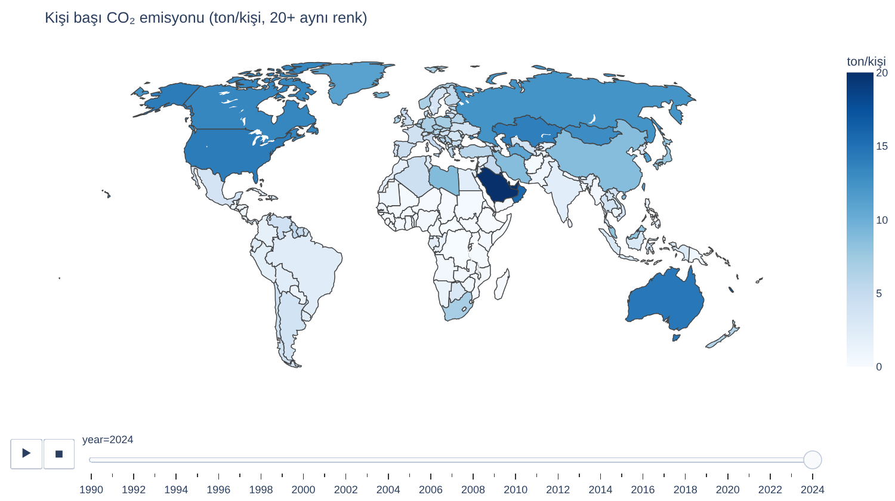
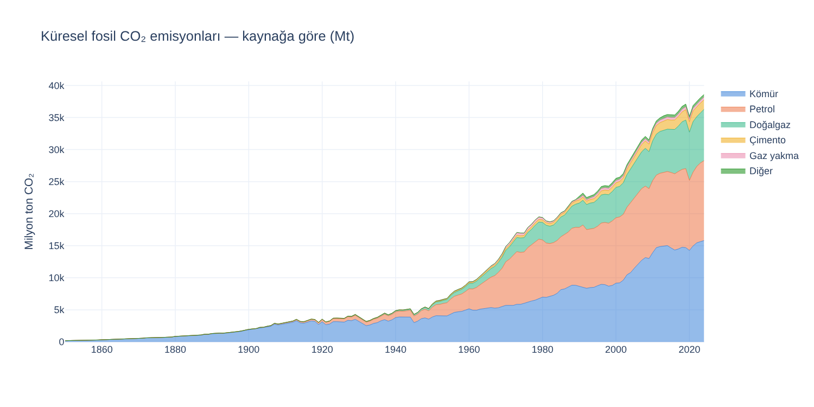
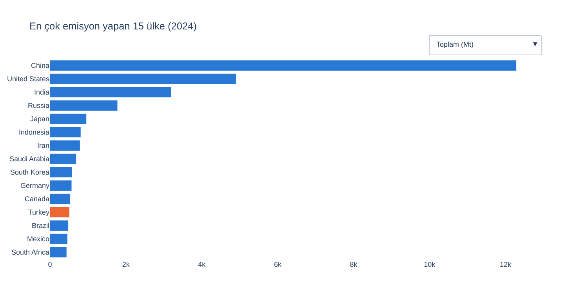
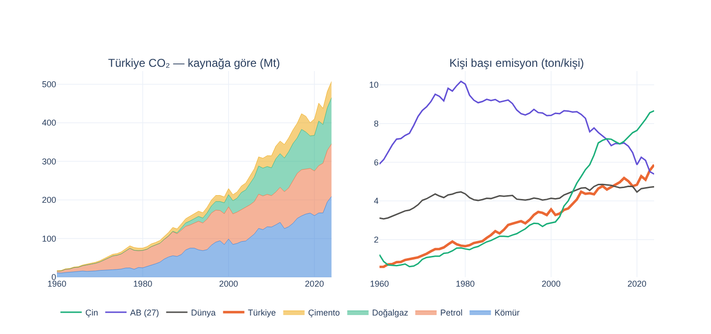
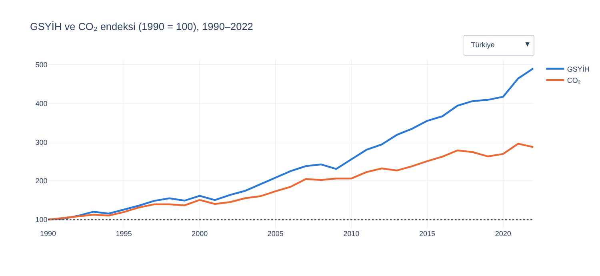
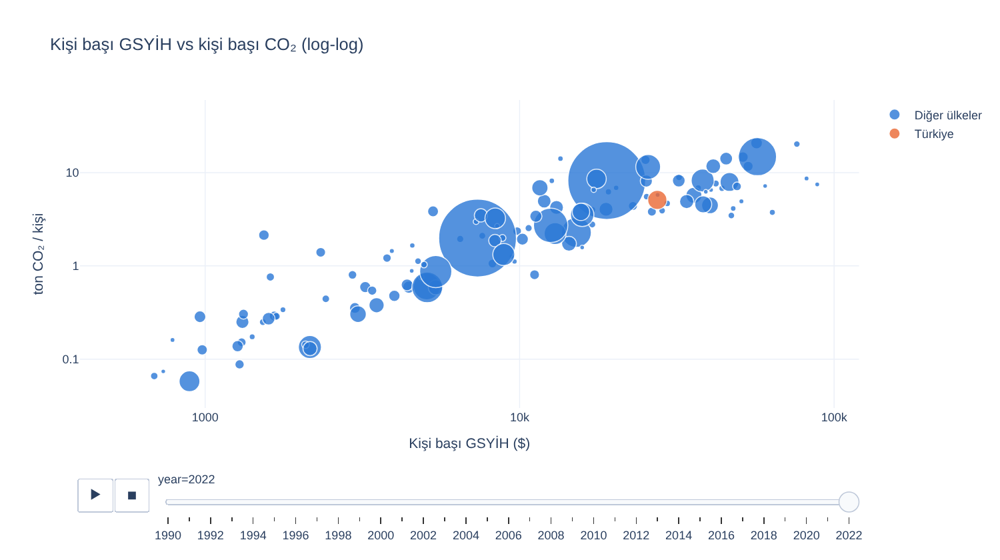
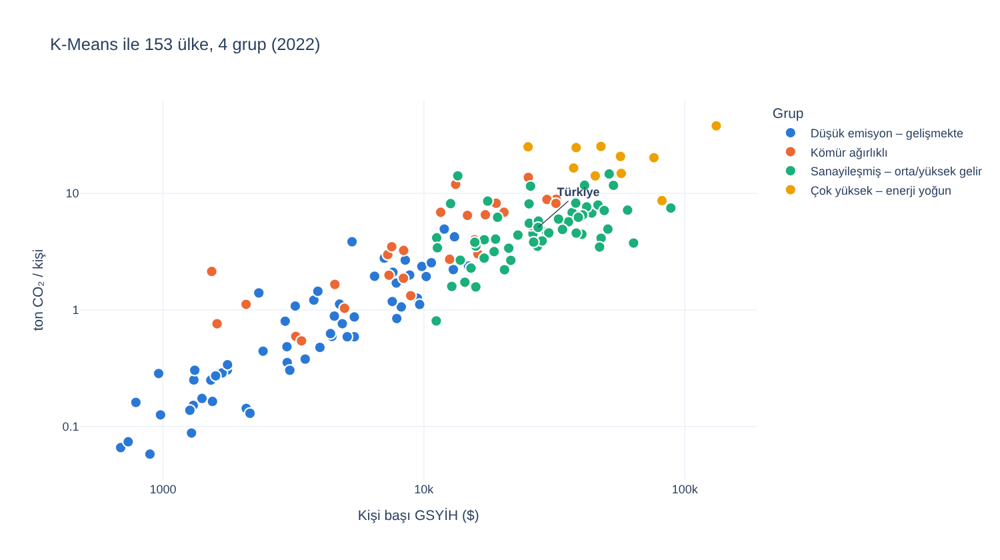
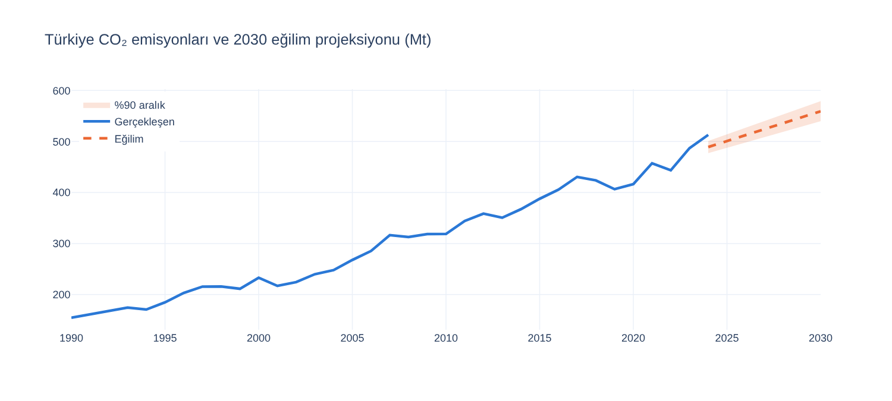

# 🌍 Küresel CO₂ Emisyonları Analizi: Türkiye Odaklı

<p align="center">
  
  
  
  
  
</p>

<p align="center">
  <a href="https://nbviewer.org/github/Memreu/CO2-Emissions-Analysis-Turkey/blob/main/co2_emisyon_analizi.ipynb"></a>
  <a href="https://colab.research.google.com/github/Memreu/CO2-Emissions-Analysis-Turkey/blob/main/co2_emisyon_analizi.ipynb"></a>
</p>

Our World in Data'nın **1750–2024** CO₂ verisiyle hazırlanmış, **tamamen interaktif** (Plotly) bir veri analizi projesi. Küresel tablodan başlayıp Türkiye'ye odaklanıyor: emisyonlar nereden geliyor, kim ne kadar salıyor, ekonomik büyüme emisyondan ayrışıyor mu ve mevcut eğilim sürerse 2030'da nerede olacağız?

<p align="center"></p>

> 💡 **Grafikler interaktif:** Haritada yıl kaydırıcısı, emitörler grafiğinde toplam / kişi başı / kümülatif geçişi, decoupling grafiğinde ülke seçimi ve animasyonlu balon grafik var. GitHub, Plotly grafiklerini notebook önizlemesinde göstermediği için bu sayfadakiler statik kopyalar. **Interaktif hâli için [nbviewer'da aç](https://nbviewer.org/github/Memreu/CO2-Emissions-Analysis-Turkey/blob/main/co2_emisyon_analizi.ipynb).**

> 🇬🇧 **In English:** An interactive (Plotly) analysis of global CO₂ emissions from 1750 to 2024, with a focus on Turkey. Global fossil CO₂ reached **~38.6 Gt in 2024 (+70% vs 1990)** and coal is still the largest source (41%). Turkey ranks **12th** worldwide; its emissions grew **3.3×** since 1990 and its per-capita emissions (**5.9 t**) now exceed both the world average and the EU. The project also tests economic decoupling, clusters 153 countries with K-Means, and projects Turkey's 2030 emissions with bootstrap uncertainty (**~559 Mt, 90% interval 540–579**).

<details>
<summary><b>📑 İçindekiler</b></summary>

- [Öne çıkan bulgular](#öne-çıkan-bulgular)
- [Küresel tablo](#küresel-tablo)
- [Türkiye](#türkiye)
- [Büyüme ve emisyon: bağ kopuyor mu?](#büyüme-ve-emisyon-bağ-kopuyor-mu)
- [K-Means ile ülke grupları](#k-means-ile-ülke-grupları)
- [2030 projeksiyonu](#2030-projeksiyonu)
- [Kullanılan yöntemler](#kullanılan-yöntemler)
- [Kurulum ve çalıştırma](#kurulum-ve-çalıştırma)
- [Veri ve lisans](#veri-ve-lisans)
- [Sınırlılıklar ve geliştirme fikirleri](#sınırlılıklar-ve-geliştirme-fikirleri)

</details>

## Öne çıkan bulgular

| | Bulgu |
|---|---|
| 🌍 **Küresel eğilim** | 2024'te küresel fosil CO₂ **~38,6 milyar ton**; 1990'a göre **%70 artış**. Kömür hâlâ en büyük kaynak (**%41**) |
| 🏭 **En büyük emitörler** | Toplamda Çin, ABD ve Hindistan önde; kişi başında Körfez ülkeleri zirvede; kümülatifte ABD ilk sırada |
| 🇹🇷 **Türkiye** | Dünyada **12. sırada** (küresel pay **%1,33**). Emisyon 1990'dan beri **3,3 kat**, nüfus 1,56 kat arttı |
| 👤 **Kişi başı** | Türkiye **5,9 ton** ile dünya ortalamasını (4,7 t) ve AB'yi (5,4 t) geçti. Kömür payı 35 yıldır **~%41**'de sabit |
| 📈 **Decoupling** | Almanya ve İngiltere'de **mutlak ayrışma** (GSYİH ↑, CO₂ ↓). Türkiye'de **göreli ayrışma**: GSYİH ~4,9 kat, CO₂ ~2,9 kat büyüdü (1990–2022) |
| 🤖 **Kümeleme** | 153 ülke 4 profile ayrıldı; Türkiye **"Sanayileşmiş – orta/yüksek gelir"** grubunda |
| 🔮 **2030** | Mevcut eğilim sürerse **~559 Mt** (%90 aralık 540–579 Mt), 2024'e göre ~%9 artış |

**Genel çıkarım:** Türkiye büyümeyi emisyondan kısmen ayırabilmiş ama mutlak düşüşe geçmemiş; kömür bağımlılığının azalmaması, kişi başı emisyonun AB'yi geçmesinin temel nedenlerinden biri.

## Küresel tablo

Sanayi Devrimi'nden bu yana emisyonlar katlanarak artıyor. Petrol 1968–2004 arasında kömürü geride bıraktı, ama 2000'lerde Çin'in hızlı sanayileşmesiyle kömür yeniden ilk sıraya yerleşti. Doğalgazın payı ise istikrarlı şekilde büyüyor.

<p align="center"></p>

Toplam emisyonda Çin açık ara önde. Türkiye 15 büyük emitör arasında 12. sırada. İnteraktif grafikte toplam, kişi başı ve kümülatif emisyon arasında geçiş yapılabiliyor.

<p align="center"></p>

## Türkiye

Türkiye'nin emisyonu 1990'dan bu yana 3,3 katına çıktı ve kaynak dağılımında kömürün payı neredeyse hiç değişmedi. Kişi başı emisyon 2015'te dünya ortalamasını geçti ve son yıllarda AB'nin de üzerine çıktı, çünkü AB emisyonlarını düşürürken Türkiye'ninki artmaya devam ediyor.

<p align="center"></p>

## Büyüme ve emisyon: bağ kopuyor mu?

Bir ülke zenginleşirken emisyonunu artırmadan büyüyebilir mi? Türkiye'de ekonomi emisyondan daha hızlı büyüyor (**göreli ayrışma**), ama emisyon hâlâ artıyor. Almanya ve İngiltere gibi ülkelerde ise emisyon mutlak olarak düşüyor (**mutlak ayrışma**). İnteraktif grafikte ülke seçilebiliyor.

<p align="center"></p>

<details>
<summary><b>🫧 Gapminder tarzı animasyonlu balon grafik</b> (kişi başı GSYİH × kişi başı CO₂, 1990–2022)</summary>
<p align="center"></p>
</details>

## K-Means ile ülke grupları

153 ülke beş özelliğe göre kümelendi: kişi başı CO₂, kişi başı enerji, karbon yoğunluğu (enerji başına CO₂), kömür payı ve kişi başı GSYİH (log). Veriler standartlaştırıldı ve küme sayısı siluet skoruyla seçildi.

<p align="center"></p>

Türkiye **"Sanayileşmiş – orta/yüksek gelir"** grubunda; profil olarak en benzer ülkeler Mauritius, Kuzey Makedonya, Slovakya, Malezya ve Tayland.

## 2030 projeksiyonu

Son 15 yılın eğilimine doğrusal regresyon uygulandı ve artıkların **bootstrap**'iyle (1.000 tekrar) %90 belirsizlik aralığı hesaplandı. Eğilim yılda **+11,7 Mt** (R² = 0,92).

<p align="center"></p>

> ⚠️ Bu bir politika senaryosu değil; yalnızca *"mevcut eğilim sürerse?"* sorusunun istatistiksel cevabı.

## Kullanılan yöntemler

| Alan | Yöntemler |
|---|---|
| **Görselleştirme** | Plotly: animasyonlu koroplet harita, açılır menülü grafikler, Gapminder tarzı balon grafik, alan grafikleri |
| **Analiz** | Kaynak kırılımı, kişi başı ve kümülatif emisyon, GSYİH–CO₂ endeksleri ile decoupling analizi |
| **Makine öğrenmesi** | StandardScaler + K-Means, siluet skoruyla küme sayısı seçimi, profil tabanlı küme adlandırma |
| **Tahmin** | Doğrusal eğilim regresyonu, artık bootstrap'i ile %90 belirsizlik aralığı |

## Kurulum ve çalıştırma

```bash
git clone https://github.com/Memreu/CO2-Emissions-Analysis-Turkey.git
cd CO2-Emissions-Analysis-Turkey
pip install -r requirements.txt
jupyter lab co2_emisyon_analizi.ipynb
```

**Run ▸ Run All Cells** ile çalıştır. Veri seti (~14 MB) ilk çalıştırmada otomatik indirilir.

**Kurulum yapmadan incelemek için:**
- 🖱️ [nbviewer'da interaktif aç](https://nbviewer.org/github/Memreu/CO2-Emissions-Analysis-Turkey/blob/main/co2_emisyon_analizi.ipynb): Tüm grafikler interaktif, hiçbir şey kurmadan.
- ☁️ [Google Colab'da çalıştır](https://colab.research.google.com/github/Memreu/CO2-Emissions-Analysis-Turkey/blob/main/co2_emisyon_analizi.ipynb): Ek kurulum gerekmez.

### Klasör yapısı

```
├── co2_emisyon_analizi.ipynb   # Ana notebook (interaktif çıktılarıyla birlikte)
├── images/                     # README için grafiklerin statik kopyaları
├── requirements.txt
├── LICENSE
└── README.md
```

## Veri ve lisans

- **Veri:** Our World in Data, *CO₂ and Greenhouse Gas Emissions*, [github.com/owid/co2-data](https://github.com/owid/co2-data). 218 ülke, 1750–2024, 79 değişken. Veri **CC BY 4.0** lisanslıdır.
- **Kod:** [MIT lisansı](LICENSE).

## Sınırlılıklar ve geliştirme fikirleri

- **Yalnızca fosil CO₂.** Arazi kullanımı ve ormansızlaşma kaynaklı emisyonlar ile metan gibi diğer sera gazları kapsam dışında.
- **Üretim tabanlı muhasebe.** Emisyonlar üretildiği ülkeye yazılıyor; ithal edilen ürünlerin "gömülü" emisyonu (tüketim tabanlı muhasebe) farklı bir tablo çizebilir.
- **Projeksiyon doğrusal.** Son 15 yılın eğilimini sürdürüyor; enerji politikası, yenilenebilir yatırımları veya ekonomik şoklar modellenmiyor.
- **Küme sayısı.** Siluet skoru en yüksek k = 5'te (0,366); yorumlanabilirlik için çok yakın skorlu k = 4 (0,359) seçildi.
- **Geliştirme fikirleri:**
  - Tüketim tabanlı emisyonlarla (OWID `consumption_co2`) üretim tabanlı tabloyu karşılaştırmak
  - Türkiye'nin 2053 net sıfır hedefi için gereken yıllık azaltım hızını hesaplamak
  - Yenilenebilir enerji payı ile emisyon yoğunluğu arasındaki ilişkiyi panel regresyonla incelemek

---

**Mehmet Emre Ünlü** · [GitHub](https://github.com/Memreu) · [LinkedIn](https://www.linkedin.com/in/memreu) · [Kaggle](https://www.kaggle.com/memreu)
