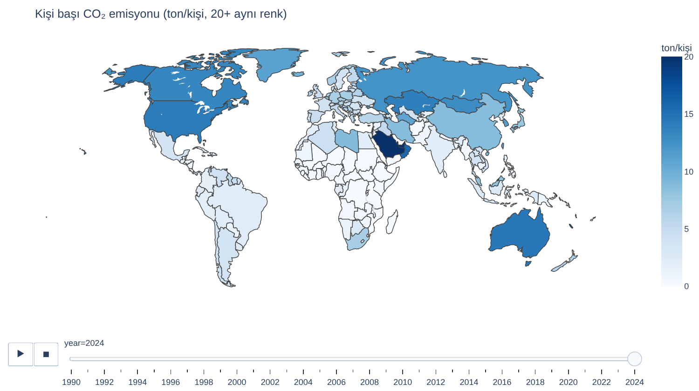
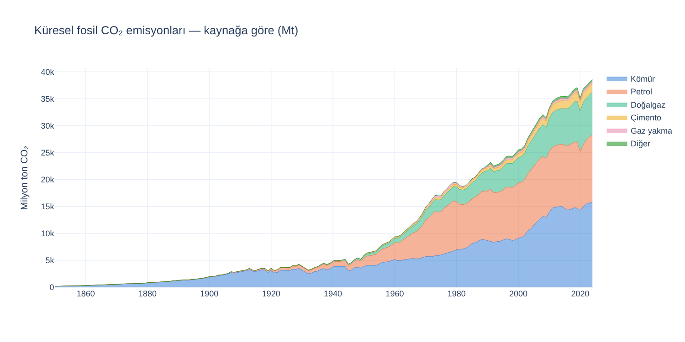
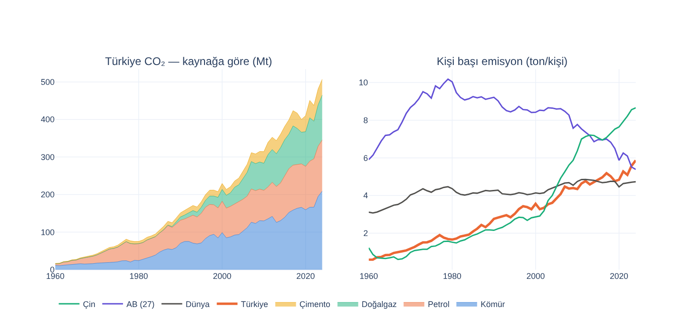
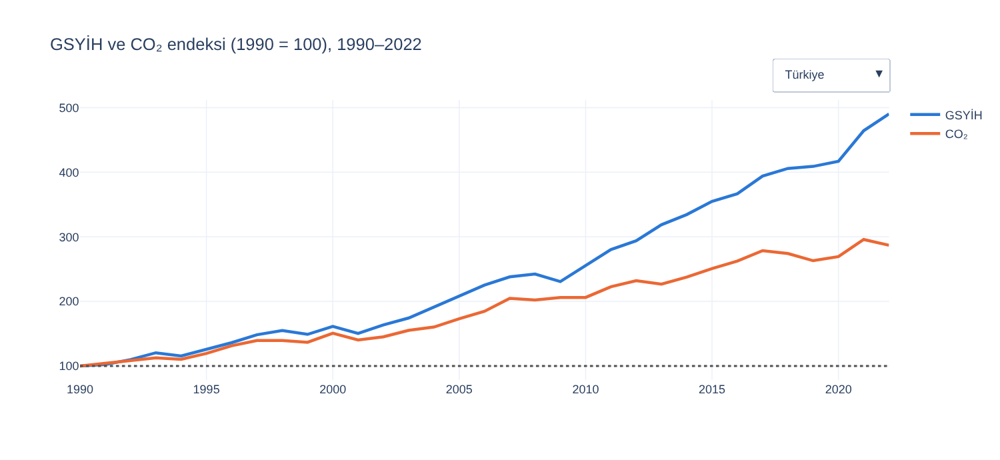
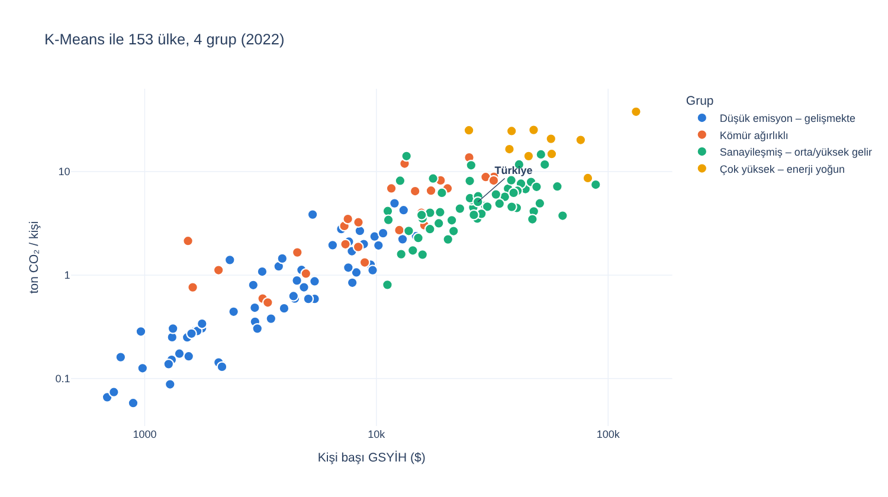
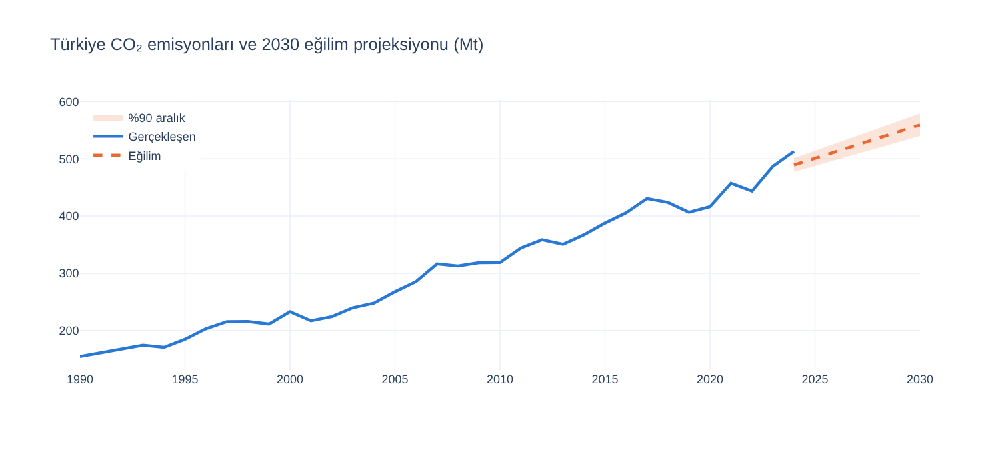

# Küresel CO₂ Emisyonları ve Türkiye

Bu projede Our World in Data'nın 1750–2024 yıllarını kapsayan CO₂ verisiyle önce küresel tabloya, sonra Türkiye'ye baktım. Cevabını aradığım sorular şunlardı: emisyonlar hangi kaynaklardan geliyor, kim ne kadar salıyor, ekonomik büyüme emisyondan ayrışıyor mu ve mevcut eğilim sürerse Türkiye 2030'da nerede olur?

Grafiklerin hepsini Plotly ile interaktif hazırladım (yıl kaydırıcılı harita, toplam / kişi başı / kümülatif arasında geçiş yapılan menü, animasyonlu balon grafik gibi). GitHub notebook önizlemesinde Plotly grafiklerini göstermediği için aşağıdakiler statik kopyalar; interaktif hâli için notebook'u [nbviewer'da](https://nbviewer.org/github/Memreu/co2-emissions-turkey/blob/main/co2_emisyon_analizi.ipynb) açabilirsiniz.



## Küresel tablo

2024'te küresel fosil CO₂ yaklaşık 38,6 milyar ton ve bu 1990'a göre %70'lik bir artış demek. Kömür hâlâ en büyük kaynak (%41). Petrol 1968–2004 arasında kömürü geride bırakmış, ama 2000'lerde Çin'in sanayileşmesiyle kömür yeniden ilk sıraya geçmiş. Toplamda Çin, ABD ve Hindistan önde; kişi başında Körfez ülkeleri, kümülatifte ise ABD ilk sırada.



## Türkiye

Türkiye dünyada 12. sırada, küresel paydaki yeri %1,33. 1990'dan bu yana nüfus 1,56 kat artarken emisyon 3,3 katına çıkmış. Kişi başı emisyon 5,9 ton ile hem dünya ortalamasının (4,7 t) hem AB'nin (5,4 t) üzerinde. Bunun bir nedeni AB'nin emisyonunu düşürürken Türkiye'ninkinin artmaya devam etmesi, diğeri de kömür payının 35 yıldır %41 civarında neredeyse hiç değişmemesi.



Büyüme ile emisyon arasındaki bağa GSYİH ve CO₂'yi 1990 = 100 olarak endeksleyip baktım. Almanya ve İngiltere'de mutlak ayrışma görülüyor: GSYİH artarken emisyon düşüyor. Türkiye'de ise göreli ayrışma var; 1990–2022 arasında GSYİH yaklaşık 4,9 kat, CO₂ yaklaşık 2,9 kat büyümüş. Yani ekonomi emisyondan hızlı büyüyor ama emisyon henüz düşmüyor.



## Ülke grupları ve 2030 projeksiyonu

153 ülkeyi beş özellikle K-Means ile kümeledim: kişi başı CO₂, kişi başı enerji, karbon yoğunluğu (enerji başına CO₂), kömür payı ve log kişi başı GSYİH. Özellikleri standartlaştırdım ve küme sayısını siluet skoruna göre seçtim. Skor en yüksek k = 5'te (0,366) çıktı, ama çok yakın olan k = 4'ü (0,359) yorumlaması daha kolay olduğu için tercih ettim. Türkiye "sanayileşmiş, orta/yüksek gelir" grubunda; profil olarak en yakın ülkeler Mauritius, Kuzey Makedonya, Slovakya, Malezya ve Tayland.



Projeksiyon için son 15 yılın verisine doğrusal bir eğilim oturttum (yılda +11,7 Mt, R² = 0,92) ve belirsizliği artıkların bootstrap'iyle (1.000 tekrar) hesapladım. Eğilim sürerse 2030'da Türkiye'nin emisyonu yaklaşık 559 Mt oluyor (%90 aralık 540–579 Mt), bu da 2024'e göre %9 kadar artış. Bunun bir politika senaryosu olmadığını, sadece "her şey böyle giderse" sorusunun istatistiksel cevabı olduğunu belirtmek isterim.



## Çalıştırmak için

```bash
git clone https://github.com/Memreu/co2-emissions-turkey.git
cd co2-emissions-turkey
pip install -r requirements.txt
jupyter lab co2_emisyon_analizi.ipynb
```

Veri seti (yaklaşık 14 MB) ilk çalıştırmada OWID'in GitHub deposundan otomatik indiriliyor. Colab'da ek kurulum gerekmiyor.

Veri: Our World in Data, [CO₂ and Greenhouse Gas Emissions](https://github.com/owid/co2-data), CC BY 4.0. Kod MIT lisansı ile paylaşılmıştır.

## Eksikler

Analiz yalnızca fosil CO₂'yi ve üretim tabanlı muhasebeyi kapsıyor; arazi kullanımı, metan gibi diğer gazlar ve ithal ürünlerdeki gömülü emisyon dışarıda kaldı. Projeksiyon da doğrusal olduğu için enerji politikası ya da ekonomik şokları hesaba katmıyor. Bir sonraki adımda OWID'in tüketim tabanlı verisiyle karşılaştırma yapmak ve 2053 net sıfır hedefi için gereken yıllık azaltım hızını hesaplamak istiyorum.
